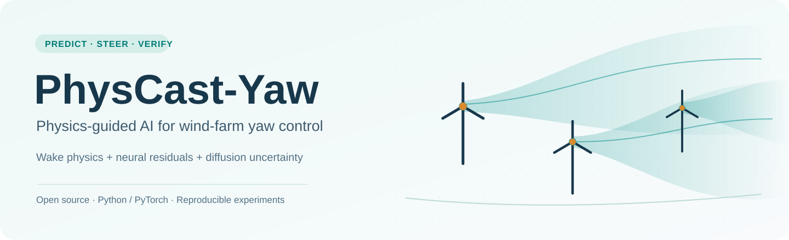
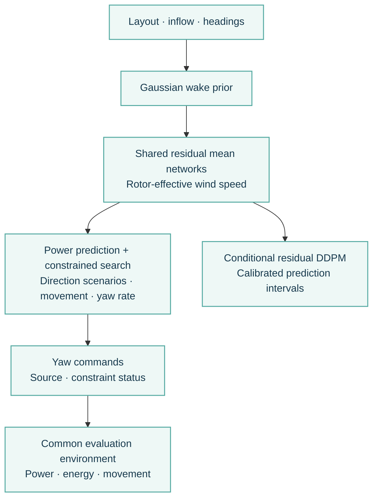
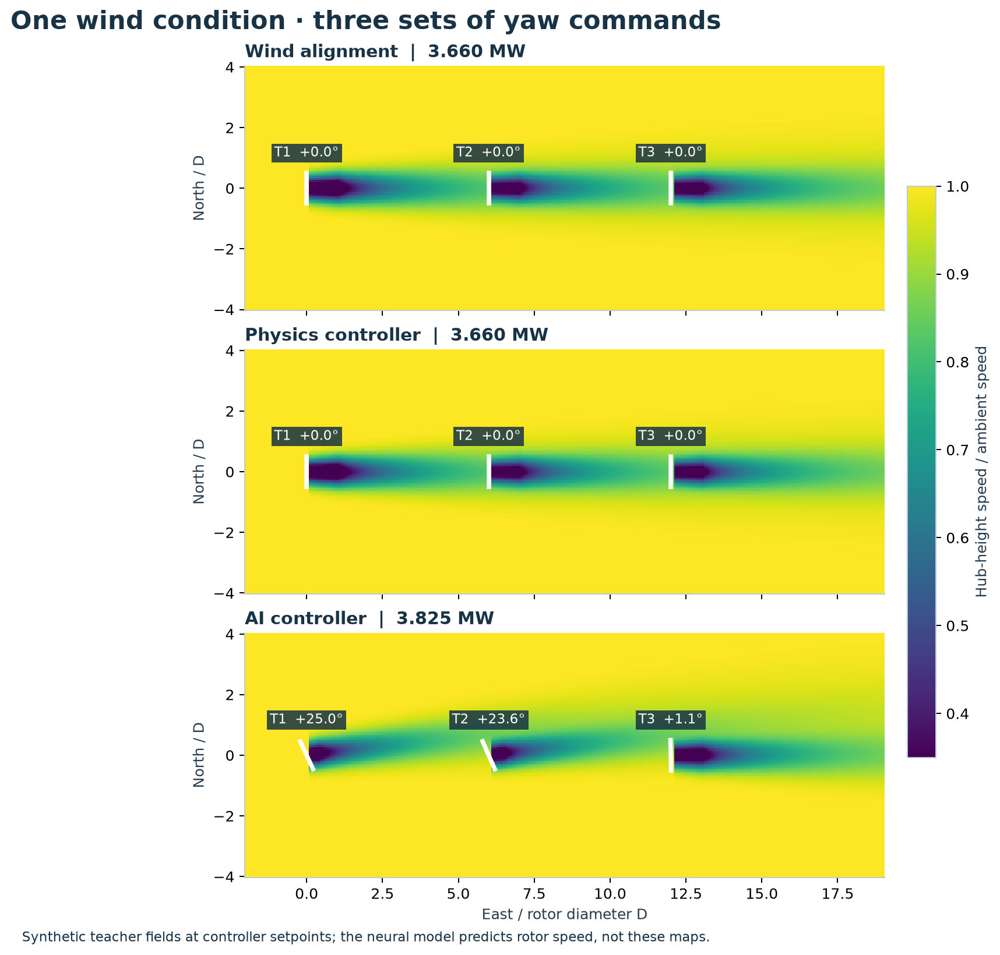
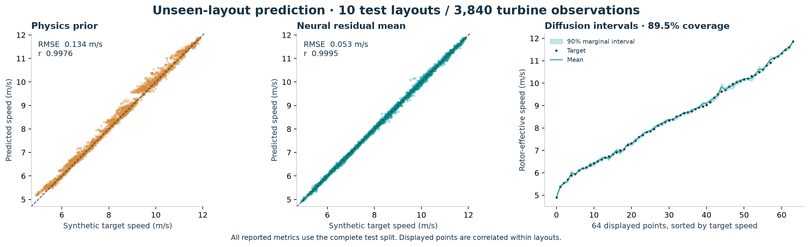
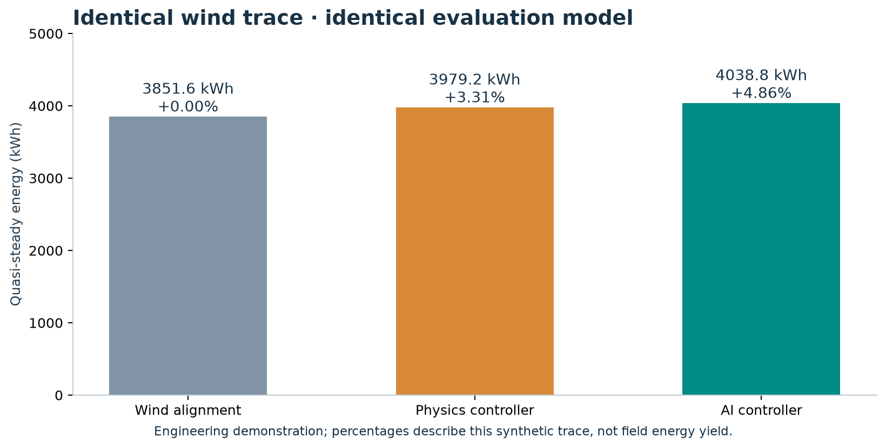

<p align="center"></p>
<p align="center">
  <a href="README.md">简体中文</a> · <a href="README.en.md"><b>English</b></a> ·
  <a href="docs/ALGORITHM.md">Equations</a> · <a href="docs/DATA.md">Data</a> · <a href="docs/VALIDATION.md">Validation</a>
</p>
<p align="center">
  <a href="https://www.python.org/downloads/"></a>
  <a href="https://pytorch.org/get-started/locally/"></a>
  <a href="https://github.com/rainbowyuyu/PhysCast-Yaw/actions/workflows/ci.yml"></a>
  <a href="LICENSE"></a>
</p>

# PhysCast-Yaw

**Predict wake effects. Choose yaw actions. Evaluate farm response.**

A standalone research implementation connecting a Gaussian wake prior, a neural mean correction, conditional residual diffusion, and constrained yaw optimization. Generate or import observations, train models, evaluate unseen layouts, optimize commands, and export reproducible comparisons from one package.

The included example runs on a CPU and uses synthetic data. No private dataset, existing checkpoint, or API key is required. CUDA training is available. Neural predictions describe rotor-effective wind speed and power; residual diffusion provides marginal uncertainty samples.

## Start here

| Task | Entry point |
|---|---|
| Run the entire experiment | [Quick start](#quick-start) |
| Change wind conditions interactively | [Dashboard](#dashboard) |
| Understand the implemented equations | [Algorithm](docs/ALGORITHM.md) |
| Train on your own observations | [Data contract](docs/DATA.md) |
| Inspect raw numbers and assumptions | [Validation](docs/VALIDATION.md) |

## Architecture



The **mean ensemble ranks control actions**. The **diffusion model estimates conditional residual uncertainty**. This separation makes prediction accuracy, interval coverage, control benefit, and actuator movement separately inspectable.

- Gaussian wake deflection, TI-dependent expansion, root-sum-square wake superposition, and nine-point rotor integration.
- Shared 16-feature residual MLPs, trained with three initialization seeds.
- A 32-step cosine DDPM with interval widening calibrated on separate layouts.
- Direction uncertainty integration, multiple search starts, per-turbine refinement, and movement/load-proxy penalties.
- Absolute nacelle-heading rate limits, nominal yaw-angle limits, explicit infeasibility, and physics fallback.
- Layout-disjoint splits, RMSE/MAE/correlation, interval coverage, three-controller replay, figures, and CSV export.

## Quick start

```bash
git clone https://github.com/rainbowyuyu/PhysCast-Yaw.git
cd PhysCast-Yaw
python -m venv .venv
```

Activate on Windows PowerShell with `.\.venv\Scripts\Activate.ps1`, or on Linux/macOS with `source .venv/bin/activate`.

```bash
python -m pip install --upgrade pip
python -m pip install -e ".[dev,app]"
physcast-yaw demo --out outputs/demo
```

The demo generates data, trains both models, evaluates the held-out layouts, optimizes yaw, replays 24 control intervals, and saves figures. Use `--quick` for a small installation smoke test; its results differ from the full benchmark below. For CUDA, first install a compatible PyTorch build using the [official selector](https://pytorch.org/get-started/locally/) and add `--device cuda:0` to `demo` or `train`.

```text
outputs/demo/
├── dataset.npz                 # Observations, layouts, and fixed split
├── model/model.pt              # Mean ensemble and residual diffusion
├── model/training.json         # Selection history and calibration
├── evaluation/metrics.json     # Test metrics
├── evaluation/predictions.csv  # Individual predictions and intervals
├── static_comparison.json
├── replay.csv                  # Per-step results for all controllers
├── control_summary.json
├── wind.csv
├── manifest.json               # Seed, configuration, and runtime versions
└── figures/                    # PNG and editable SVG
```

## Dashboard

```bash
streamlit run examples/dashboard.py
```

Select a three- or six-turbine layout, change wind speed, wind direction, turbulence intensity, and direction uncertainty, then click **Compare yaw commands**. The dashboard displays three power cards, wake maps on one color scale, individual yaw commands, model-source status, and a CSV download.



Maps and evaluation power come from the fixed synthetic teacher. The neural model predicts rotor-effective speed and power, not the complete plotted field.

## Reproduced synthetic benchmark

Seed 42; 64 layouts; 4,096 farm states; 20,480 turbine observations. Training covers two to eight turbines. The test set contains **10 unseen layouts and 3,840 observations**. Prior and teacher have different parameters within the same Gaussian model family.

| Held-out prediction metric | Physics prior | Neural mean |
|---|---:|---:|
| Rotor-speed RMSE ↓ | 0.1337 m/s | **0.0533 m/s** |
| Rotor-speed MAE ↓ | 0.0792 m/s | **0.0346 m/s** |
| Speed Pearson r ↑ | 0.99763 | **0.99955** |
| Derived turbine-power RMSE ↓ | 105.23 kW | **42.40 kW** |

Speed RMSE decreases by **60.17%**. Calibrated nominal 90% intervals cover **89.45%** of test observations with a mean width of **0.1286 m/s**. Power targets are derived from the same generic power curve, rather than an independent power measurement.



A three-turbine, 24-step, 48-minute quasi-steady replay gives:

| Controller | Synthetic energy | Gain over alignment | Total nacelle travel |
|---|---:|---:|---:|
| Rate-limited alignment | 3,851.57 kWh | — | 112.24° |
| Physics-based yaw control | 3,979.21 kWh | +3.31% | 144.54° |
| AI mean-based yaw control | **4,038.75 kWh** | **+4.86%** | 300.67° |

AI control produces **1.50%** more energy than physics control and uses more yaw motion. Both outcomes matter when selecting control penalties.



This experiment tests the implementation and correction between related synthetic models. Replay integrates each interval's endpoint steady power; yaw-travel losses and wake propagation are absent. Field benefits require independent measured or high-fidelity evaluation. All reported numbers are linked to [saved JSON/CSV evidence](docs/VALIDATION.md).

## Modular commands

```bash
physcast-yaw generate --out outputs/data.npz --layouts 64 --samples-per-layout 64
physcast-yaw train --data outputs/data.npz --out outputs/model --device cpu
physcast-yaw evaluate --data outputs/data.npz --model outputs/model/model.pt --out outputs/evaluation
physcast-yaw optimize --config configs/three_turbines.json --model outputs/model/model.pt --heading 270 270 270 --out outputs/command.json
physcast-yaw optimize --config configs/three_turbines.json --out outputs/physics-command.json
physcast-yaw replay --config configs/three_turbines.json --model outputs/model/model.pt --wind-csv outputs/demo/wind.csv --out outputs/replay.csv
```

`--heading` takes absolute nacelle headings, not yaw misalignment. Omitting `--model` selects physics-only control. Every command has `--help`. See [`examples/python_api.py`](examples/python_api.py) for Python use and [the data guide](docs/DATA.md) for `import-csv`.

## Repository layout

```text
PhysCast-Yaw/
├── README.md / README.en.md
├── pyproject.toml
├── LICENSE / CITATION.cff
├── CONTRIBUTING.md
├── configs/                     # Three- and six-turbine JSON scenes
├── src/physcast_yaw/
│   ├── config.py                # Typed farm, turbine, and wind contracts
│   ├── physics.py               # Wakes, rotor integration, and features
│   ├── data.py                  # Generation, import, splits, and checks
│   ├── learning.py              # Mean ensemble, DDPM, and evaluation
│   ├── control.py               # Optimization, fallback, and replay
│   ├── plots.py                 # Scientific PNG/SVG figures
│   ├── demo.py                  # Reproducible end-to-end experiment
│   └── cli.py
├── examples/                    # Python API and Streamlit dashboard
├── tests/
├── docs/
│   ├── ALGORITHM.md             # Code-aligned equations
│   ├── DATA.md                  # Dataset and import contracts
│   ├── VALIDATION.md            # Protocol, evidence, and interpretation
│   ├── assets/                  # Original artwork and computed figures
│   └── benchmark/               # Small public JSON/CSV result bundle
└── .github/workflows/ci.yml      # Linux and Windows checks
```

## Scope and extension

The default turbine is a generic 5 MW engineering curve with a 126 m rotor, not a complete OEM or NREL reference model. Configuration accepts 1–24 homogeneous turbines; the demo learns from 2–8. A different turbine specification, more turbines than recorded in training, or unsupported feature values trigger physics fallback.

The mean correction is bounded by the prior wake deficit and vanishes where the prior predicts no wake. DDPM samples are marginal turbine residuals, not joint spatial or temporal fields. Physics enters through the wake prior, power curve, and output bounds; this implementation does not include a Navier–Stokes/PINN loss. The load term is a side-force proxy, not fatigue damage. The parked policy holds heading and is not a storm controller.

To extend the project, supply the correct turbine power/thrust curves, import documented rotor-effective observations, retain layout-disjoint tests, and evaluate control in an independent environment. FLORIS, FAST.Farm, or LES can be integrated behind the physics interface.

## Development and citation

```bash
python -m ruff check src tests examples
python -m pytest -q
python -m build
```

Code, synthetic examples, and original artwork are [MIT licensed](LICENSE). Use GitHub's **Cite this repository** or [`CITATION.cff`](CITATION.cff) to cite the software. See [CONTRIBUTING.md](CONTRIBUTING.md) for development guidance and [Issues](https://github.com/rainbowyuyu/PhysCast-Yaw/issues) for questions.
