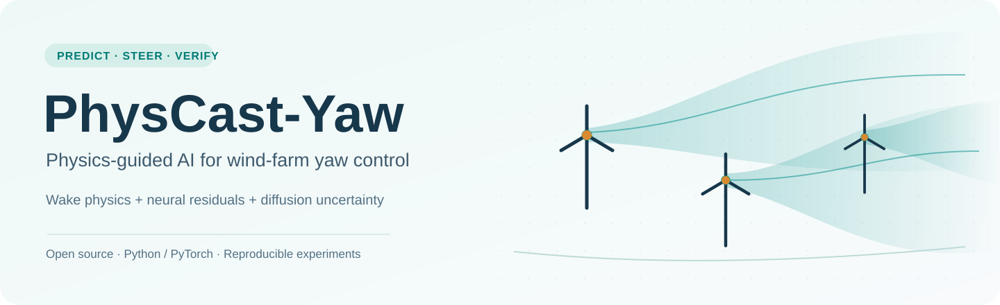
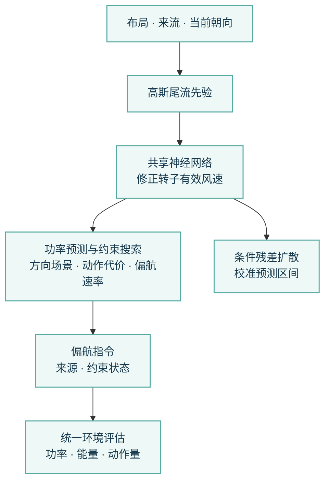
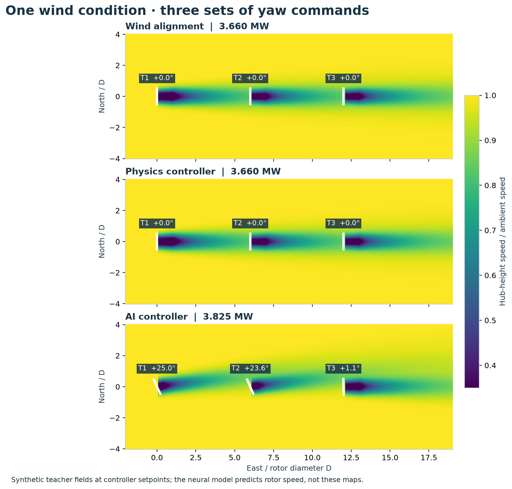
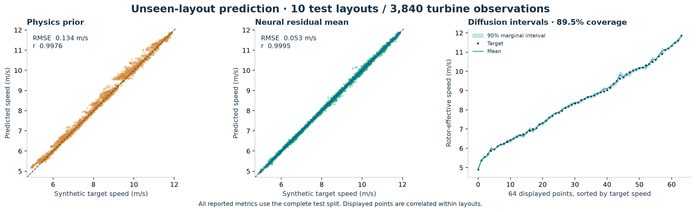
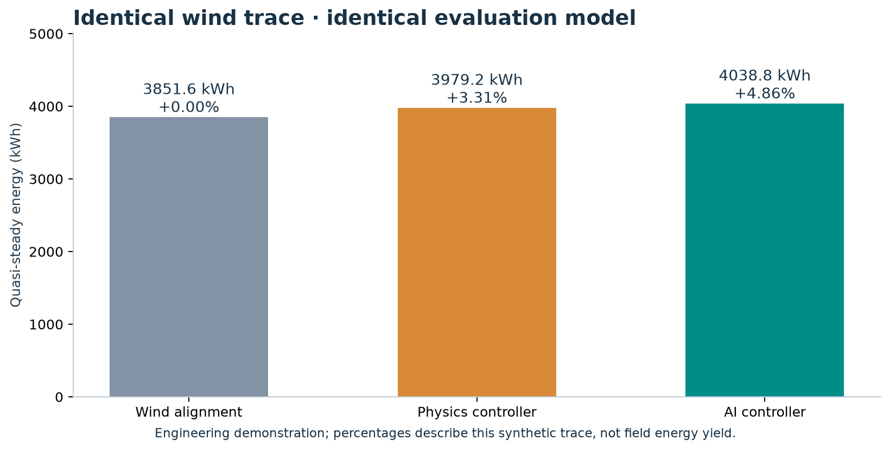

<p align="center">
  
</p>

<p align="center">
  <a href="README.md"><b>简体中文</b></a> · <a href="README.en.md">English</a> ·
  <a href="docs/ALGORITHM.md">算法与公式</a> · <a href="docs/DATA.md">接入数据</a> ·
  <a href="docs/VALIDATION.md">复现实验</a>
</p>
<p align="center">
  <a href="https://www.python.org/downloads/"></a>
  <a href="https://pytorch.org/get-started/locally/"></a>
  <a href="https://github.com/rainbowyuyu/PhysCast-Yaw/actions/workflows/ci.yml"></a>
  <a href="LICENSE"></a>
</p>

# PhysCast-Yaw

**预测尾流影响，选择偏航动作，验证整场响应。**

PhysCast-Yaw 是一个可独立运行的风场偏航控制研究项目。它把高斯尾流先验、神经网络均值修正、条件残差扩散和带执行器约束的控制搜索串成完整流程：生成或导入数据 → 训练 → 未见布局测试 → 选取偏航角 → 回放 → 图表与 CSV 导出。

公开版本自带可复现的合成数据实验，不需要私有数据、已有模型权重或 API 密钥。CPU 即可跑通，也提供 CUDA 训练入口。模型预测各台风机的转子有效风速与功率；扩散模型生成残差样本，用于描述单机预测的不确定性。

## 从哪开始

| 你想做的事 | 入口 |
|---|---|
| 直接跑完整实验 | [三步启动](#三步启动) |
| 调整风向、风速并比较偏航方案 | [交互工作台](#交互工作台) |
| 看模型、扩散和控制公式 | [算法说明](docs/ALGORITHM.md) |
| 使用自己的风机观测数据 | [CSV 格式与数据划分](docs/DATA.md) |
| 核对每一个展示数值 | [实验记录与原始结果](docs/VALIDATION.md) |

## 算法如何工作



控制器用**均值模型**比较动作；扩散模型负责**条件残差分布**。通过这个分工，可以分别检查平均预测是否准确、区间是否覆盖观测，以及控制收益是否伴随更多机舱运动。

| 模块 | 已实现内容 |
|---|---|
| 尾流先验 | 偏航偏转、TI 相关扩张、多尾流 RSS 叠加、9 点转子积分 |
| 神经网络 | 每台风机共享的 16 维特征编码、3 个初始化种子的残差 MLP |
| 扩散 | 32 步余弦 DDPM、条件去噪、独立校准布局上的 90% 区间修正 |
| 自动偏航 | 风向不确定性积分、多起点搜索、逐机坐标细化、动作与侧向载荷代理惩罚 |
| 执行器 | 绝对机舱朝向速率约束、名义偏航角约束、不可行状态显式返回 |
| 模型回退 | 检查机型、风机数量和扩展特征包络；不支持的候选被拒绝，无支持种子时转物理模型 |
| 评估与展示 | 布局分组测试、误差与相关性、区间覆盖、三方案回放、交互视图与 CSV |

## 三步启动

### 1. 获取项目并创建环境

```bash
git clone https://github.com/rainbowyuyu/PhysCast-Yaw.git
cd PhysCast-Yaw
python -m venv .venv
```

Windows PowerShell：

```powershell
.\.venv\Scripts\Activate.ps1
```

Linux / macOS：

```bash
source .venv/bin/activate
```

### 2. 安装

```bash
python -m pip install --upgrade pip
python -m pip install -e ".[dev,app]"
```

GPU 训练需要与你的 CUDA 环境匹配的 PyTorch，安装命令见 [PyTorch 官方选择器](https://pytorch.org/get-started/locally/)。只运行算法时可用 `pip install -e .`，不安装交互界面和开发工具。

### 3. 运行完整实验

```bash
physcast-yaw demo --out outputs/demo
```

该命令实际执行数据生成、均值网络训练、扩散训练、独立测试、自动偏航、24 步回放和绘图。只检查环境可用性时运行 `physcast-yaw demo --quick --out outputs/smoke`；快速模式不对应下方的完整实验数值。

```text
outputs/demo/
├── dataset.npz                 # 数据、布局与固定划分
├── model/model.pt              # 训练得到的均值网络与扩散权重
├── model/training.json         # 训练与模型选择记录
├── evaluation/metrics.json     # 测试集指标
├── evaluation/predictions.csv  # 逐条预测与区间
├── static_comparison.json      # 同一静态工况的控制方案
├── replay.csv                  # 每步、每种控制方法的结果
├── control_summary.json        # 能量、增益与动作量
├── wind.csv                    # 回放来流
├── manifest.json               # 参数、种子与运行环境
└── figures/                    # PNG + 可编辑 SVG
```

## 交互工作台

```bash
streamlit run examples/dashboard.py
```

选择 3 台或 6 台布局，修改风速、风向、湍流强度与风向不确定性，然后点击 **Compare yaw commands**。页面同时给出三组功率卡片、共用色阶的尾流图、逐机偏航角和 CSV 下载；会显示 AI 是否使用了物理回退。



图中的速度场和评估功率由同一个合成高斯环境计算，神经网络输出是转子风速与功率。三幅图的来流、布局和色阶一致。

## 实际运行的示例结果

固定种子 42，64 个布局、4,096 个风场状态、20,480 条单机观测；测试集包含未参与训练、选模或区间校准的 **10 个布局、3,840 条观测**。训练机组数为 2–8 台。先验和合成教师采用不同参数，但属于同一类高斯模型。

| 未见布局上的预测指标 | 物理先验 | AI 均值模型 |
|---|---:|---:|
| 转子风速 RMSE ↓ | 0.1337 m/s | **0.0533 m/s** |
| 转子风速 MAE ↓ | 0.0792 m/s | **0.0346 m/s** |
| 风速 Pearson r ↑ | 0.99763 | **0.99955** |
| 派生单机功率 RMSE ↓ | 105.23 kW | **42.40 kW** |

风速 RMSE 相对下降 **60.17%**。扩散样本经校准后，名义 90% 区间在测试集的覆盖率为 **89.45%**，平均宽度 **0.1286 m/s**。功率标签来自同一通用功率曲线，属于风速预测的派生评估。



三台风机、24 个 120 秒控制区间，共 48 分钟的准稳态回放：

| 控制方法 | 合成环境能量 | 相对对风控制增益 | 全场累计机舱运动 |
|---|---:|---:|---:|
| 速率受限对风控制 | 3,851.57 kWh | — | 112.24° |
| 物理模型偏航控制 | 3,979.21 kWh | +3.31% | 144.54° |
| AI 均值偏航控制 | **4,038.75 kWh** | **+4.86%** | 300.67° |

AI 方案比物理控制多获得 **1.50%** 能量，同时机舱动作更多。这里同时保留收益与动作代价，方便调整控制权重。



这些结果检验了端到端实现和同类合成模型之间的修正能力。回放按每步终点稳态功率积分，没有模拟偏航行程中的功率或尾流传播延迟；实际风场收益需要使用独立实测或高保真仿真再次评估。[查看完整实验协议与 CSV](docs/VALIDATION.md)。

## 分模块使用

```bash
# 合成训练集：完整布局分组，避免同一布局分散到训练和测试
physcast-yaw generate --out outputs/data.npz --layouts 64 --samples-per-layout 64

# 训练；有合适的 CUDA 环境时改为 --device cuda:0
physcast-yaw train --data outputs/data.npz --out outputs/model --device cpu

# 测试与预测区间
physcast-yaw evaluate --data outputs/data.npz --model outputs/model/model.pt --out outputs/evaluation

# AI 自动偏航；heading 是绝对机舱朝向，不是偏航误差
physcast-yaw optimize --config configs/three_turbines.json --model outputs/model/model.pt --heading 270 270 270 --out outputs/command.json

# 不传模型时，使用物理先验控制
physcast-yaw optimize --config configs/three_turbines.json --out outputs/physics-command.json

# 同一来流序列下，三组控制各自维护独立执行器状态
physcast-yaw replay --config configs/three_turbines.json --model outputs/model/model.pt --wind-csv outputs/demo/wind.csv --out outputs/replay.csv
```

Python 接口示例见 [`examples/python_api.py`](examples/python_api.py)。每个命令都有 `--help`；导入实测/仿真数据使用 `import-csv`，详细字段、单位和来源记录见 [数据说明](docs/DATA.md)。

## 项目结构

```text
PhysCast-Yaw/
├── README.md / README.en.md    # 中英文导航、示例与使用说明
├── pyproject.toml             # 安装、依赖与命令行入口
├── LICENSE / CITATION.cff     # MIT 许可与软件引用
├── CONTRIBUTING.md
├── configs/
│   ├── three_turbines.json
│   └── six_turbines.json
├── src/physcast_yaw/
│   ├── config.py              # 风机、风场、来流和单位契约
│   ├── physics.py             # 高斯尾流、风速场、16 维条件特征
│   ├── data.py                # 生成、CSV 导入、布局划分与校验
│   ├── learning.py            # 均值集成、残差扩散、校准与评估
│   ├── control.py             # 约束优化、模型回退与回放
│   ├── plots.py               # 科研图表，PNG/SVG 导出
│   ├── demo.py                # 完整可复现实验
│   └── cli.py                 # 八个命令行子命令
├── examples/                  # Python 接口与 Streamlit 工作台
├── tests/                     # 物理、数据、学习和控制回归测试
├── docs/
│   ├── ALGORITHM.md           # 与代码对应的完整公式
│   ├── DATA.md                # 数据契约和接入方式
│   ├── VALIDATION.md          # 实验协议、结果与解释
│   ├── assets/                # 原创封面、真实运行生成的图
│   └── benchmark/             # 公开示例的 JSON / CSV 证据
└── .github/workflows/ci.yml    # Linux / Windows 自动检查
```

## 模型范围与扩展

- 默认风机是 **5 MW、直径 126 m** 的通用工程参数，并非某厂商或 NREL 参考机型的完整复现；可用 JSON 修改。
- 配置支持 1–24 台同型风机，示例训练覆盖 2–8 台。数量超过训练记录上限、机型不同或特征不受支持时，AI 控制回退物理模型。
- 网络以尾流先验为中心修正转子风速；先验认为完全无尾流的位置不产生均值修正。扩散提供逐机边缘残差样本，未建模机组间联合随机场。
- 物理关系通过尾流先验、功率曲线和输出约束进入算法。本仓库没有把一个未实现的 Navier–Stokes/PINN 残差当作训练项。
- `load_weight` 惩罚的是侧向载荷代理量，不是疲劳寿命；停机策略是保持朝向，不承担极端天气控制。

接入真实数据时，先替换对应机型的功率与推力曲线，再用有来源的转子有效风速标签训练，并保留布局独立测试。可进一步把物理接口接到 FLORIS、FAST.Farm 或 LES，同时沿用控制接口和结果导出。

## 开发与引用

```bash
python -m ruff check src tests examples
python -m pytest -q
python -m build
```

实现、测试、合成示例和原创配图采用 [MIT](LICENSE) 许可。引用软件可使用 GitHub 的 **Cite this repository** 或 [`CITATION.cff`](CITATION.cff)。问题与改进建议欢迎提交 [Issue](https://github.com/rainbowyuyu/PhysCast-Yaw/issues)。
