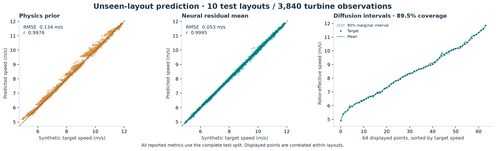
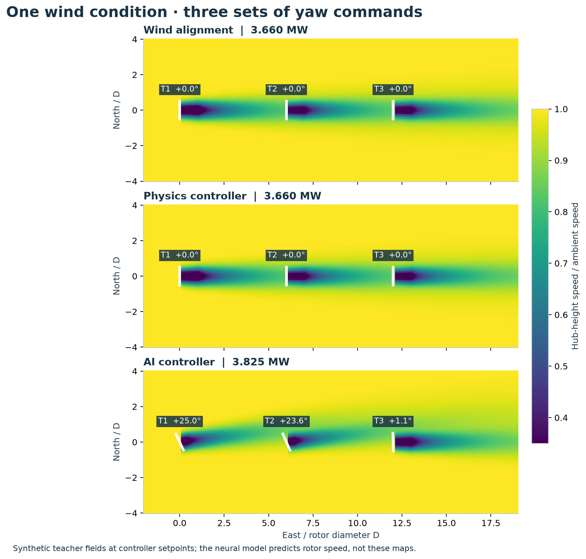
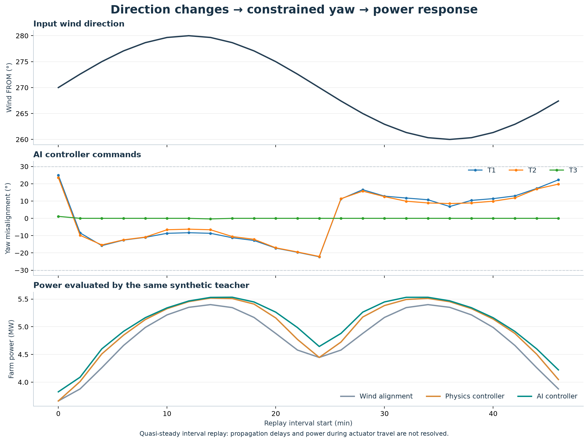

# Reproducible validation record

[首页](../README.md) · [English](../README.en.md) · [Algorithm](ALGORITHM.md) · [Data](DATA.md)

The published example was executed on **2026-11-18** with the protocol below. All numbers on the README are drawn from this run. Saved tables are available without rerunning training.

## Protocol and environment

```bash
physcast-yaw demo --out outputs/demo
```

| Item | Setting |
|---|---|
| Source | `synthetic_gaussian_teacher` |
| Seed | 42 |
| Dataset | 64 layouts × 64 farm states; 20,480 turbine observations |
| Farm size in generated data | 2–8 turbines |
| Split | Complete layout groups; 38 train / 10 validation / 6 calibration / 10 test |
| Mean network | Three initialization seeds; at most 100 epochs each; validation selection |
| Diffusion | 32 steps; 1,200 training updates; validation selection |
| Evaluation samples | 64 residual draws per test observation |
| Control layout | Three generic 5 MW turbines at (0,0), (756,0), (1512,0) m |
| Replay | 24 intervals × 120 s; 48 minutes |
| Platform | Windows, CPU, Python 3.12.10 |
| Numerical libraries | NumPy 2.5.5, PyTorch 2.15.0+cpu, Matplotlib 3.11.2 |

The [manifest](benchmark/manifest.json) records the actual run environment. SciPy was installed during this run but is not used by the algorithm and is not a required dependency. [Data provenance](benchmark/data_provenance.json) records the generated-data/model hashes, teacher settings, and exact split counts. CPU/GPU implementations and dependency versions can produce numerical variation; the saved tables record this run rather than a universal bitwise result.

The train/validation/calibration/test split and training budgets were fixed before the full demo. Validation selects checkpoints; test observations are used for reporting. The synthetic teacher is used to generate labels and evaluate commands, not to choose commands during optimization. Both prior and teacher belong to the same Gaussian model family with different expansion and deflection parameters.

## 1. Prediction on held-out layouts

| Metric | Physics prior | Neural mean |
|---|---:|---:|
| Speed RMSE (m/s) | 0.1337007 | 0.0532507 |
| Speed MAE (m/s) | 0.0792141 | 0.0345718 |
| Speed bias (m/s) | +0.0573051 | +0.0077008 |
| Speed Pearson r | 0.9976266 | 0.9995492 |
| Derived power RMSE (kW) | 105.2317 | 42.4000 |
| Derived power MAE (kW) | 55.3838 | 24.3155 |
| Derived power Pearson r | 0.9971105 | 0.9994454 |

The test includes 3,840 turbine observations from 10 layouts. Relative speed RMSE reduction is

$$
100\left(1-\frac{0.0532507262}{0.1337006965}\right)=60.17\%.
$$

Lower RMSE/MAE indicates closer magnitudes; Pearson correlation describes covariation. Ambient speed variation contributes to the high correlation of both models. These pooled metrics should not be read as a test of every layout equally or as validation of yaw-action ranking alone. The added synthetic noise means prediction targets differ from the noiseless teacher.



Source: [metrics.json](benchmark/metrics.json), [predictions.csv](benchmark/predictions.csv).

## 2. Diffusion uncertainty

| Quantity | Result |
|---|---:|
| Target interval | 90% marginal |
| Held-out coverage | 89.4531% |
| Mean interval width | 0.1285852 m/s |
| Draws per observation | 64 |

Intervals describe individual rotor-speed observations after separate calibration. The training generator has a common scene noise component, while sampling is independent per turbine; simultaneous farm coverage and joint power uncertainty are not evaluated. Calibration widens sample quantiles empirically. It does not turn correlated layout observations into independent calibration units.

The mean-network improvement and DDPM coverage measure different parts of the system. This benchmark does not include an ablation establishing that DDPM uncertainty improves yaw selection: the current control risk term uses mean-ensemble disagreement.

## 3. Static yaw comparison

Inflow is 8 m/s from 270°, with TI 0.08. All methods are evaluated by the same noiseless synthetic teacher:

| Method | Yaw commands, T1 / T2 / T3 | Teacher-evaluated farm power |
|---|---|---:|
| Alignment | 0° / 0° / 0° | 3,660.25 kW |
| Physics optimization | 0° / 0° / 0° | 3,660.25 kW |
| AI optimization | 25.00° / 23.61° / 1.13° | 3,825.42 kW |

The optimizer reports **scenario-expected predicted power**, while this table reports teacher power at the **nominal** direction. They are different quantities and should not be subtracted to claim a point-prediction error. All algorithms receive the same direction uncertainty and actuator settings.



The shared color scale is rotor-height speed divided by ambient speed. These are teacher fields under the selected commands; the neural network itself does not generate the full plotted field. Source: [static_comparison.json](benchmark/static_comparison.json).

## 4. Quasi-steady control replay

| Method | Energy (kWh) | Gain over alignment | Total nacelle travel | Fallback steps | Infeasible steps |
|---|---:|---:|---:|---:|---:|
| Rate-limited alignment | 3,851.57 | 0.00% | 112.24° | 0 | 0 |
| Physics optimization | 3,979.21 | +3.31% | 144.54° | 0 | 0 |
| AI optimization | 4,038.75 | +4.86% | 300.67° | 0 | 0 |

AI energy is 1.50% above physics optimization on this trace. Its higher travel is an operating tradeoff, not a free improvement. The movement term can be increased to favor quieter setpoints, but the published run is retained unchanged.



Read the plots from top to bottom: common inflow; the selected upstream yaw; power evaluated in the common environment. Different heading states are retained for each controller. Rate-limited alignment may have nonzero yaw after a wind-direction change.

The energy sum uses final steady power times the full control interval. It omits actuator travel losses and delayed downstream wake response. The control layout is a separate demonstration scenario, not a held-out measured field site. The run is one seeded synthetic trace, without across-site confidence intervals.

Source: [replay.csv](benchmark/replay.csv), [wind.csv](benchmark/wind.csv), [control_summary.json](benchmark/control_summary.json).

## 5. Verify the evidence

```bash
python examples/verify_benchmark.py
```

This recomputes speed RMSE, MAE, bias, correlation, coverage, width, control energy, relative gains, and total heading movement from the committed CSV files. It also verifies [SHA256 hashes](benchmark/checksums.json) of the public evidence and figures. Power-error metrics remain recorded from the original evaluation; the compact prediction CSV does not include the yaw labels needed to independently reconstruct them.

```bash
python -m ruff check src tests examples
python -m pytest -q
python -m build
physcast-yaw demo --quick --out outputs/smoke
```

Tests cover upstream/downstream behavior, yaw mirroring, layout transformations, superposition, rotor integration, input validation, split leakage, checkpoint round trips, sampling reproducibility, heading wrap/rate constraints, shared headings across uncertainty scenarios, domain fallback, replay energy units, and CLI import. The CI workflow runs Python 3.10 on Linux and Python 3.12 on Windows; the Linux job also executes the quick end-to-end demo.

## 6. Moving to independent validation

The present result supports an executable synthetic benchmark and correction of a parameter-mismatched prior. To measure practical transfer, retain the same controller interface and compare on independent observation or simulation campaigns:

1. Use documented turbine curves and synchronize inflow, yaw, and rotor-equivalent labels.
2. Hold out full sites/layouts and control interventions before model selection.
3. Evaluate downstream responses and action rankings as well as pooled prediction error.
4. Replay all commands through the same independent dynamic environment, including yaw travel and wake delay.
5. Compare energy, actuator motion, uncertainty coverage, and measured structural loads where available.

This sequence distinguishes learning a response from improving a control decision, while keeping every reported gain tied to its evaluation environment.
